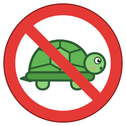

<p align="center">
  
</p>

<h1 align="center"><em>NoTurtle!</em></h1>

<p align="center">
  <b>We're going to get rid of the turtle, and it's going to be beautiful. Believe me.</b>
</p>

<p align="center">
  
  
  
</p>

Folks, let me tell you about the turtle. You start a VM in VirtualBox (great
software, by the way, very good software) and what do you see? A little green
turtle. In the status bar. Slow. Very slow. Low energy. Big, strong developers
come up to me, tears in their eyes, and they say, *"Sir, why is my VM so slow?"*
And I tell them: it's the turtle.

Here's what's happening, and nobody talks about this. Windows is running its own
hypervisor. Its **own**! So VirtualBox can't use your CPU's VT-x/AMD-V directly.
It has to go through Hyper-V. A total disaster. Very sad!

*NoTurtle* is one `.bat` file. One beautiful file. It turns the Windows
hypervisor off, you restart, and the turtle is gone. **Gone!** Your VMs are fast
again, and the status bar shows the blue **V** chip. That's called winning.

No turtles were harmed. We asked them to leave, very nicely, and they left.
Very respectful.

## Get *NoTurtle*

It's free. Totally free. Nobody's ever seen a deal like this.

- **📥 Download** — right-click
  [NoTurtle.bat](https://github.com/cottonella/NoTurtle/raw/main/NoTurtle.bat)
  → **Save link as…**
- **🧑‍💻 Clone** — `git clone https://github.com/cottonella/NoTurtle`

Windows may warn you about an unknown `.bat` file from the internet. Very
suspicious, I understand. It's about 35 lines. Read them. Beautiful lines, the
best lines. Then **More info → Run anyway**.

## How to use

So easy. Incredibly easy. Many people are saying it's the easiest thing they've
ever done.

**Double-click** `NoTurtle.bat` → click **Yes** when Windows asks for admin
rights (it asks all by itself, very smart script, the smartest) → let it
finish → **Restart**. *Restart*, not *Shut down*! With Fast Startup, the turtle
hides in Shut down. Sneaky. Very sneaky turtle.

Click **No** at the admin prompt? Then nothing changes. Nothing! Your call.

Start a VM. No turtle? 🎉 Winning. You want proof? Open **msinfo32**. The line
*"A hypervisor has been detected"*: gone. Totally gone.

## What it switches off

Very strong list. Some people say the strongest list.

| What                                                                              | Why                                                                |
| --------------------------------------------------------------------------------- | ------------------------------------------------------------------ |
| 🐢 the Windows hypervisor at boot                                                  | it's the turtle's house, and we're taking it back                  |
| 🧱 Hyper-V, Virtual Machine Platform, Windows Hypervisor Platform, Windows Sandbox | they keep rebuilding the house. Not anymore!                       |
| 🛡️ Memory integrity, Virtualization-based security, Credential Guard               | they live in the house and keep it standing. Very loyal. Too loyal |
| 🔐 BitLocker, paused for **one** restart                                           | so it doesn't ask for your recovery key. Nobody likes that. Nobody |

## The fine print

The fairest fine print you've ever read. Very fair.

- **WSL2, Docker Desktop and Windows Sandbox** need the hypervisor too, so they
  stop working. You can't have both pets. Tough choice. I make tough choices
  every day.
- **Memory integrity** protects you from bad drivers. Malicious drivers,
  vulnerable drivers, very bad drivers. It will be off. That's the deal, and
  every deal has a price.
- **Windows Home** has no Hyper-V or Sandbox, so those lines print
  *"feature name is unknown"*. Fine. Totally fine. Fake features, they were
  never there.
- **Turtle still there** after a proper restart? Then something below Windows
  settings is keeping it on: a firmware (UEFI) lock, a work or school policy, or
  Windows Hello Enhanced Sign-in Security on some newer laptops. This little
  script doesn't touch those. Very powerful people. We'll see what happens.

## Changed your mind?

You want the turtle back? Some people do. I don't understand it, but okay. In a
terminal opened **as administrator**:

```bat
bcdedit /set hypervisorlaunchtype auto
```

Then turn **Memory integrity** back on (Windows Security → Device security →
Core isolation), re-tick the features in **Turn Windows features on or off**,
and restart. The turtle comes back. Slow, but back. It's your choice, it's a
free country.

---

<p align="center">
  &nbsp;
  <a href="https://ko-fi.com/cottonella"></a>
</p>
